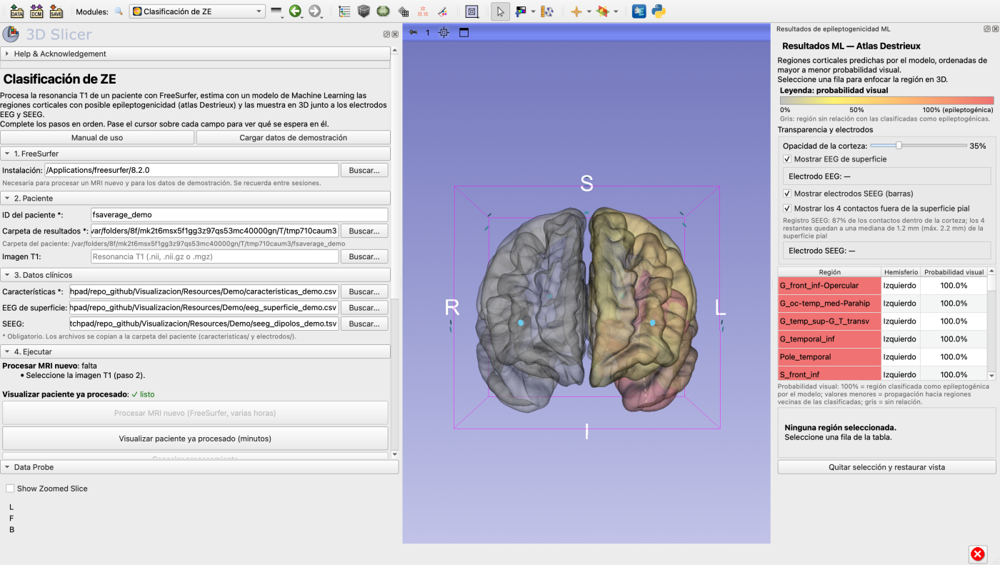

# ClasificacionZE: extensión de 3D Slicer

Procesa la resonancia T1 de un paciente con FreeSurfer, estima con un modelo de
Machine Learning las regiones corticales con posible epileptogenicidad (atlas
Destrieux, 148 regiones) a partir de sus marcadores sEEG, y las muestra en 3D
junto a los electrodos EEG de superficie y SEEG.

*Epileptogenic zone classification for 3D Slicer: FreeSurfer processing of a T1
MRI, machine-learning prediction of epileptogenic cortical regions from sEEG
markers, and 3D visualization with scalp EEG and SEEG electrodes. User
interface in Spanish.*



> Herramienta de apoyo a la investigación (trabajo de grado, Pontificia
> Universidad Javeriana). Sus resultados no sustituyen la evaluación clínica.

## Módulos

| Módulo | Descripción |
|---|---|
| **Clasificación de ZE** (categoría *Epilepsy*) | Ejecuta FreeSurfer sobre la T1, aplica el modelo de zonas epileptogénicas y muestra en 3D las regiones, los electrodos EEG/SEEG y una tabla de resultados. |

## Instalación

**Desde el Extensions Manager de Slicer** (cuando la extensión esté en el
catálogo): *View > Extensions Manager*, busque **ClasificacionZE**, pulse
*Install* y reinicie Slicer.

**Desde este repositorio** (sin compilar nada):

1. Instale [3D Slicer](https://download.slicer.org) 5.x y, para procesar MRI,
   [FreeSurfer](https://surfer.nmr.mgh.harvard.edu) con su `license.txt`
   (macOS o Linux).
2. Descargue el código: botón **Code > Download ZIP** (o la última versión en
   *Releases*) y descomprímalo en una carpeta fija.
3. En Slicer: *Edit > Application Settings > Modules > Additional module
   paths*, pulse **Add**, elija la carpeta `Visualizacion/` del código
   descomprimido y reinicie Slicer.
4. Abra el módulo **Clasificación de ZE** (categoría *Epilepsy*).

La primera vez que se ejecuta el modelo, la extensión pide permiso para
instalar en el Python de Slicer los paquetes que necesita (pandas, joblib,
scikit-learn 1.9.1, nibabel), que se descargan de PyPI.

## Prueba rápida

En el módulo: **Cargar datos de demostración** → **Visualizar paciente ya
procesado**. Usa el cerebro *fsaverage* de FreeSurfer y datos clínicos
sintéticos de `Visualizacion/Resources/Demo/` (generados con
`Docs/herramientas/generar_datos_demo.py`).

## Documentación

| Documento | Para quién |
|---|---|
| [Manual de uso](Visualizacion/Resources/Docs/MANUAL_USUARIO.md) | Usuarios. También se abre desde el botón **Manual de uso** del módulo. |
| [Protocolo de pruebas de usabilidad](Docs/usabilidad/PROTOCOLO_PRUEBAS_USABILIDAD.md) | Equipo que organiza las pruebas con usuarios. |
| [Formularios](Docs/usabilidad/FORMULARIOS.md) | Consentimiento, cuestionarios (SEQ, SUS) y hoja de observación. |
| [Evaluación heurística](Docs/usabilidad/EVALUACION_HEURISTICA.md) | Problemas de usabilidad corregidos y pendientes. |

## Tests

Desde esta carpeta (macOS; en Linux, la ruta del ejecutable de Slicer):

```bash
/Applications/Slicer.app/Contents/MacOS/Slicer --no-splash --no-main-window --testing \
  --additional-module-paths "$PWD/Visualizacion" \
  --python-code "import slicer.testing; slicer.testing.runUnitTest(['$PWD/Visualizacion'], 'Visualizacion')"
```

## Estructura

| Carpeta | Contenido |
|---|---|
| `Visualizacion/` | Módulo de Slicer: interfaz y orquestación (`Visualizacion.py`), recursos, manual y datos de demostración. |
| `Pipeline/` | Un script por paso de FreeSurfer (31) y `pipeline_principal.py`, que los ejecuta en orden. |
| `Inferencia/` | Modelo de SOZ (`.joblib`) y su adaptador. |
| `VisualizacionML/` | Visualización 3D: corteza y regiones, EEG de superficie y SEEG. |
| `Docs/` | Documentación de usabilidad, herramientas y la entrada del catálogo de extensiones (`Docs/catalogo/`). |

## Modelo

`Inferencia/soz_ensamble_sEEG_15pacientes.joblib` es el modelo final del
experimento IMP-T-Q: un ensamble (ExtraTrees + regresión logística) que usa
solo los cuatro marcadores sEEG por región (EI, HFO, ER y SE). Está entrenado
con los 15 pacientes del estudio, sin excluir ninguno, y con scikit-learn 1.9.1.
El rendimiento esperado en un paciente nuevo es el de la validación dejando un
paciente fuera (LOPO): AUROC media por paciente de 0,869. El modelo **ordena**
las regiones de más a menos sospechosa; no da una probabilidad segura.

## Autores

- Juan Andrés Martínez Castellanos, Pontificia Universidad Javeriana
- Ana Rebeca Torres Vargas, Pontificia Universidad Javeriana

## Licencia

[PolyForm Noncommercial 1.0.0](LICENSE.txt). Cualquiera puede usar, estudiar,
modificar y redistribuir el código con fines no comerciales (investigación,
docencia, uso personal, universidades, hospitales públicos...). El uso
comercial no está permitido. Se eligió esta licencia, más restrictiva que MIT
o Apache, para que la herramienta no se use con fines de lucro.

El modelo incluido (`Inferencia/soz_ensamble_sEEG_15pacientes.joblib`) se
distribuye con la misma licencia. FreeSurfer no se incluye y tiene su propia
licencia.
