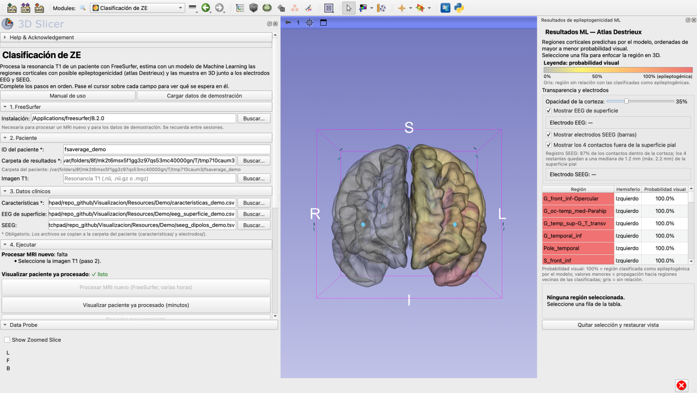
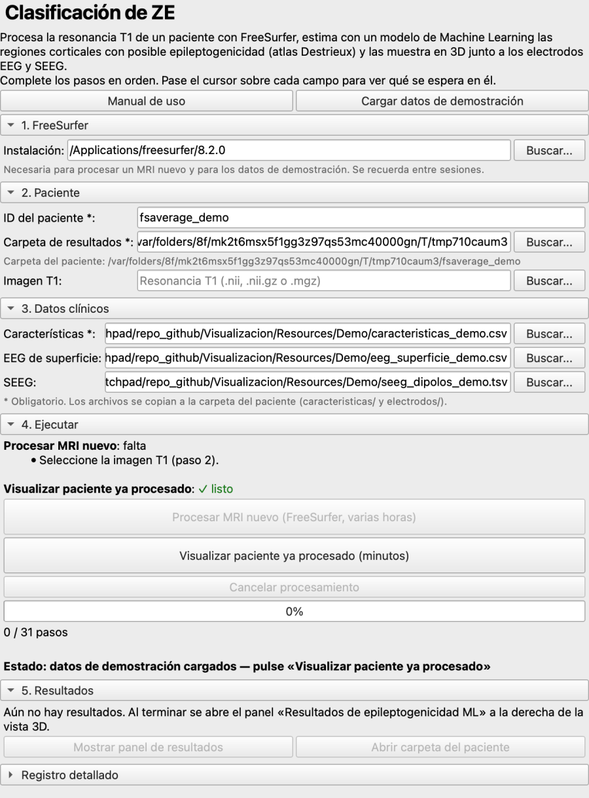
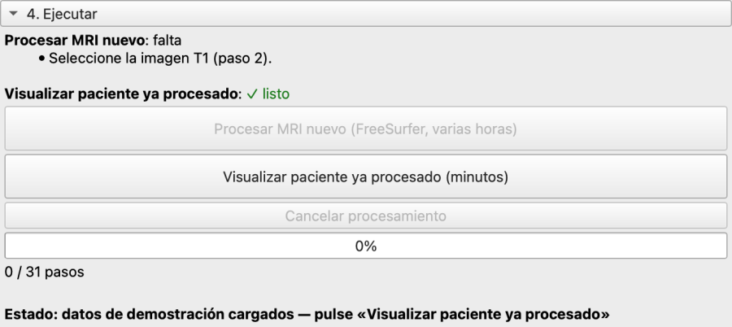
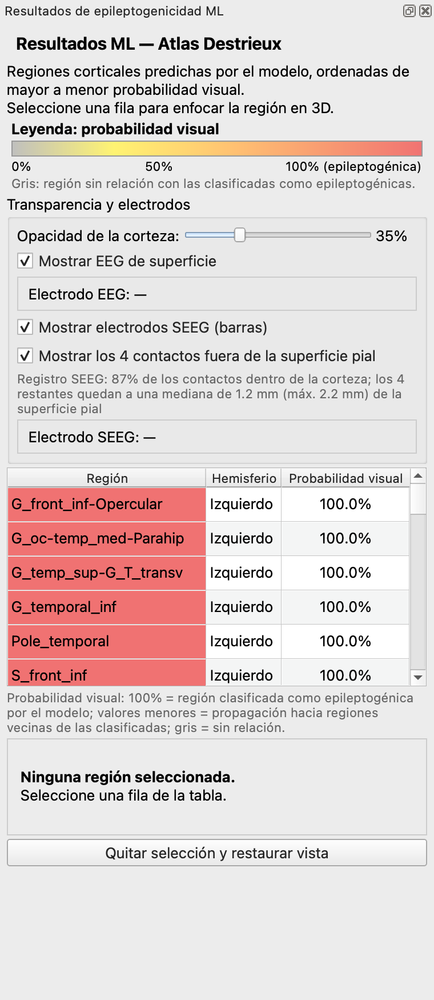
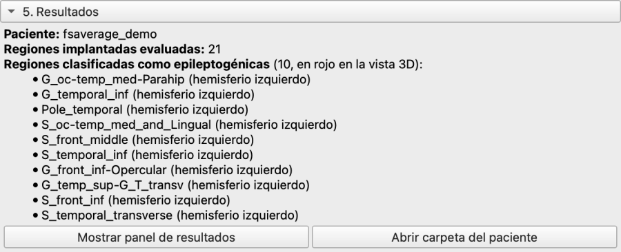

# Manual de uso — Clasificación de ZE

Extensión de 3D Slicer para estimar las zonas epileptogénicas (ZE) de un paciente
a partir de su resonancia T1 y de sus registros sEEG, y para explorarlas en 3D.

> **Aviso.** Es una herramienta de apoyo a la investigación. Sus resultados no
> sustituyen la evaluación clínica ni deben usarse como único criterio para
> decisiones terapéuticas.

---

## 1. Qué hace la extensión

1. **Procesa la T1 con FreeSurfer** (31 pasos, varias horas): reconstruye la
   corteza del paciente y la divide en las 148 regiones del atlas Destrieux.
2. **Ejecuta el modelo de Machine Learning**: a partir de las características
   sEEG de cada región clasifica qué regiones son epileptogénicas (probables
   zonas de inicio de las crisis, SOZ).
3. **Muestra los resultados en 3D**: la corteza del paciente con las regiones
   coloreadas según su probabilidad, una tabla de resultados y, si se indican,
   los electrodos EEG de superficie y SEEG.



## 2. Requisitos

| Necesita | Detalle |
|---|---|
| 3D Slicer | Versión 5.x. |
| Sistema operativo | macOS o Linux para procesar MRI nuevos y para la demostración (FreeSurfer no funciona en Windows). |
| FreeSurfer | Versión 7 u 8 instalada, con su archivo `license.txt` (gratuito en surfer.nmr.mgh.harvard.edu/registration.html). Solo para procesar MRI nuevos y para la demostración. |
| Espacio en disco | Unos 2 GB por paciente procesado. |
| Tiempo | Procesar un MRI nuevo: varias horas. Visualizar un paciente ya procesado: 1–3 minutos. |
| Internet | Solo la primera vez: la extensión pide permiso para instalar los paquetes de Python que necesita el modelo (pandas, joblib, scikit-learn, nibabel) y los descarga de PyPI. Pulse **Instalar**. |

## 3. Abrir la extensión

1. En Slicer, abra el selector de módulos (la lupa o el menú desplegable de
   módulos) y escriba **Clasificación de ZE**. También está en la categoría
   **Epilepsy**.
2. El panel muestra cinco pasos numerados. Complételos en orden.

Si la extensión no aparece, instálela desde el *Extensions Manager* o añada la
carpeta `Visualizacion` en *Edit > Application Settings > Modules >
Additional module paths* y reinicie Slicer.



## 4. Probarla en 5 minutos (datos de demostración)

Sirve para conocer la extensión sin datos propios ni esperar a FreeSurfer.

1. En el paso **1. FreeSurfer**, compruebe que figura la carpeta de
   instalación de FreeSurfer (la extensión la busca sola; si no, pulse
   **Buscar...**).
2. Pulse **Cargar datos de demostración** (arriba del panel). La extensión
   prepara el paciente `fsaverage_demo` y rellena los pasos 2 y 3.
3. En **4. Ejecutar**, pulse **Visualizar paciente ya procesado (minutos)**.
4. Explore los resultados (apartado 7).

> Los datos clínicos de la demostración son **sintéticos**: no corresponden a
> ningún paciente. El cerebro es *fsaverage*, el cerebro de referencia promedio
> que incluye FreeSurfer.

## 5. Preparar los archivos del paciente

### 5.1 Imagen T1 (para procesar un MRI nuevo)

Resonancia magnética T1 del paciente en formato `.nii`, `.nii.gz` o `.mgz`.

### 5.2 Características sEEG (obligatorio)

Archivo `.csv` con **una fila por región Destrieux (148 en total)** y estas
columnas:

| Columna | Contenido |
|---|---|
| `region_destrieux` | Nombre de la región Destrieux seguido de ` L` (izquierdo) o ` R` (derecho). Ej.: `Pole_temporal L`. |
| `seeg_EI_valor` | Marcador EI (índice de epileptogenicidad) de la región. |
| `seeg_HFO_valor` | Marcador HFO (oscilaciones de alta frecuencia) de la región. |
| `seeg_ER_valor` | Marcador ER de la región, calculado como en el protocolo del proyecto. |
| `seeg_SE_valor` | Marcador SE de la región, calculado como en el protocolo del proyecto. |

Los valores no tienen que estar en una escala concreta: el modelo los compara
entre las regiones del mismo paciente.

* Separador `;` con decimal `,` (formato habitual de Excel en español) **o**
  separador `,` con decimal `.`.
* Las regiones **no implantadas** se dejan con las celdas vacías. El modelo
  solo puntúa las regiones implantadas.
* Ejemplo:

```
region_destrieux;seeg_EI_valor;seeg_HFO_valor;seeg_ER_valor;seeg_SE_valor
Pole_temporal L;0,8123;0,7411;0,6950;0,7702
G_front_middle L;0,1220;0,0421;0,3362;0,3902
S_calcarine R;;;;
```

El archivo de la demostración (`Resources/Demo/caracteristicas_demo.csv`
dentro de la extensión) sirve de plantilla con los 148 nombres.

### 5.3 EEG de superficie (opcional)

Archivo `.csv` con un electrodo del sistema 10-20 por fila en la primera
columna, con o sin encabezado `electrode`:

```
electrode
Fp1
Fp2
Cz
O1
```

Se reconocen: Fp1, Fp2, F3, F4, F7, F8, F9, F10, Fz, C3, C4, Cz, T7, T8, T9,
T10, P3, P4, P7, P8, P9, P10, Pz, O1 y O2. Las posiciones son las estándar
del sistema 10-20 adaptadas a la cabeza del paciente; **no** son las posiciones
digitalizadas reales.

### 5.4 SEEG (opcional)

Archivo `.tsv` (separado por tabuladores) con al menos las columnas:

| Columna | Contenido |
|---|---|
| `Channel` | Canal bipolar (`A1-A2`) o contacto (`A1`). El prefijo es el nombre del electrodo. |
| `World` | Coordenadas `x y z` en mm del canal, en el espacio del escáner de la T1 del paciente. |

```
Channel	World
TP1-TP2	-34.6 4.5 -38.6
TP2-TP3	-34.4 3.0 -35.4
```

A partir de los canales bipolares, la extensión reconstruye la posición de cada
contacto. Las coordenadas deben corresponder **a la misma T1** que se procesó:
si no, los electrodos quedan fuera del cerebro y el panel lo advierte.

## 6. Procesar un paciente

### 6.1 Paciente nuevo (con FreeSurfer)

1. **1. FreeSurfer**: carpeta de instalación (la que contiene
   `SetUpFreeSurfer.sh` y `license.txt`).
2. **2. Paciente**:
   * **ID del paciente**: por ejemplo `paciente01`. Solo letras, números,
     `-`, `_` y `.` (sin espacios ni tildes).
   * **Carpeta de resultados**: carpeta común donde se guardan todos los
     pacientes. Debajo se muestra la carpeta exacta del paciente.
   * **Imagen T1**.
3. **3. Datos clínicos**: características (obligatorio), EEG y SEEG
   (opcionales).
4. **4. Ejecutar**: el panel indica qué falta para cada botón. Cuando
   **Procesar MRI nuevo** muestra *✓ listo*, púlselo.
5. La extensión revisa el contenido de los archivos **antes** de empezar
   (para que un error de formato no aparezca horas después) y pide
   confirmación.
6. Durante el procesamiento verá el paso actual (por ejemplo *Paso 23/31:
   Corrección topológica*), la barra de progreso y el tiempo transcurrido.
   Puede seguir usando Slicer, pero **no lo cierre**: al cerrarlo, o al pulsar
   **Cancelar procesamiento**, FreeSurfer se detiene y habría que empezar de
   nuevo.
7. Al terminar FreeSurfer, el modelo y la visualización se ejecutan solos.

Si el paciente ya había sido procesado, la extensión pregunta si desea
**visualizarlo sin reprocesar** o **reprocesarlo** (lo que sobrescribe los
resultados anteriores).

### 6.2 Paciente ya procesado (sin FreeSurfer)

Para volver a ver un paciente, o para probar otras características o
electrodos, sin repetir las horas de FreeSurfer:

1. Indique el mismo **ID** y la misma **carpeta de resultados** con que se
   procesó.
2. Indique los datos clínicos (paso 3).
3. Pulse **Visualizar paciente ya procesado (minutos)**.

No necesita la T1 ni FreeSurfer.



## 7. Interpretar los resultados

Al terminar se abre a la derecha el panel **Resultados de epileptogenicidad
ML** y la vista 3D muestra la corteza del paciente.



### 7.1 Colores de la corteza

| Color | Significado |
|---|---|
| Rojo | Región clasificada por el modelo como epileptogénica (probable zona de inicio de las crisis). Probabilidad visual 100 %. |
| Naranja / amarillo | Región vecina de las clasificadas como epileptogénicas (propagación). Cuanto más cerca de ellas, más intenso. |
| Gris | Región sin relación con las clasificadas como epileptogénicas. |

La **leyenda** del panel muestra la escala de colores.

### 7.2 Regiones clasificadas como epileptogénicas y probabilidad visual

* La sección **5. Resultados** del módulo lista las **regiones clasificadas
  como epileptogénicas**: las que el modelo marca como probables zonas de
  inicio de las crisis. Son las mismas que aparecen en rojo y con 100 % en la
  tabla.

  

* La **probabilidad visual** (tabla y colores) vale 100 % en esas regiones y un
  valor menor en sus vecinas. Sirve para leer el mapa; **no es una probabilidad
  clínica** de que la región sea epileptogénica.
* La probabilidad que estima el modelo para cada región no se muestra en la
  interfaz; está en el archivo `predicciones_soz_modelo.csv` (apartado 8.1).

### 7.3 Tabla de regiones

* Las regiones están ordenadas de mayor a menor probabilidad visual. El color de
  la celda es el color de la región en 3D.
* **Clic en una fila**: la vista 3D enfoca esa región y oculta las demás
  regiones coloreadas. Abajo aparecen sus datos.
* **Quitar selección y restaurar vista**: vuelve a mostrar todas las regiones y
  la cámara anterior.

### 7.4 Transparencia y electrodos

* **Opacidad de la corteza**: hace la corteza más transparente para ver los
  electrodos SEEG del interior. Con SEEG, empieza en 35 %.
* **Mostrar EEG de superficie / Mostrar electrodos SEEG**: muestran u ocultan
  cada tipo de electrodo. Solo aparecen si se cargó su archivo.
* **Al pasar el cursor** sobre un electrodo, el panel indica su nombre (y, en
  SEEG, el contacto y sus coordenadas).
* **Registro SEEG**: porcentaje de contactos que caen dentro de la corteza.
  Si es muy bajo (en rojo), el archivo SEEG probablemente no corresponde a la
  T1 de este paciente.

### 7.5 Otros controles

* **Mostrar panel de resultados** (sección 5 del módulo): vuelve a abrir el
  panel si lo cerró.
* **Abrir carpeta del paciente**: abre la carpeta con los archivos generados.
* La vista 3D se maneja como siempre en Slicer: arrastrar con el botón
  izquierdo para rotar; rueda o arrastrar con el botón derecho para acercar;
  botón central o Mayús + botón izquierdo para desplazar.

## 8. Archivos que genera

En `<carpeta de resultados>/<ID del paciente>/`:

| Archivo | Contenido |
|---|---|
| `predicciones_soz_modelo.csv` | Resultado completo del modelo para las 148 regiones (apartado 8.1). Se abre con Excel. |
| `predicciones_epileptogenicidad.csv` | Probabilidad visual de las regiones coloreadas (apartado 8.2). |
| `registro_pipeline.log` | Registro completo del procesamiento con FreeSurfer. |
| `caracteristicas/`, `electrodos/` | Copia de los archivos clínicos usados. |
| `mri/`, `surf/`, `label/` | Salida de FreeSurfer. |

### 8.1 `predicciones_soz_modelo.csv`

Separador `;` y decimal `,` (se abre directamente con Excel en español). Una
fila por región; primero las clasificadas como epileptogénicas.

| Columna | Contenido |
|---|---|
| `region_destrieux` | Región Destrieux con su hemisferio (` L` izquierdo, ` R` derecho). |
| `origen` | `SOZ marcada (modelo)`: el modelo la clasifica como epileptogénica (zona de inicio de las crisis). `propagación`: no está clasificada; su valor proviene de una región vecina clasificada. |
| `probabilidad_soz` | **Probabilidad calibrada**: estimación del modelo, entre 0 y 1, de que la región sea zona de inicio de las crisis, ajustada para que se parezca a la frecuencia real observada en los pacientes del entrenamiento. En las regiones `SOZ marcada` es su propia probabilidad; en las de `propagación` es 0,6 × la de la región clasificada vecina más alta (o 0,3 × si es vecina de segundo orden), y 0 lejos de ellas. La región más sospechosa suele rondar 0,6: el modelo **ordena** las regiones de más a menos sospechosa, pero no da certeza. |
| `puntaje_soz` | `probabilidad_soz` reescalada de 0 a 1 dentro del paciente (1 = su región más sospechosa). Sirve para comparar regiones del mismo paciente; no es una probabilidad. |

### 8.2 `predicciones_epileptogenicidad.csv`

Separador `,` y decimal `.`. Contiene solo las regiones coloreadas en 3D.

| Columna | Contenido |
|---|---|
| `label` | Región con prefijo de hemisferio (`ctx_lh_` izquierdo, `ctx_rh_` derecho). |
| `probabilidad` | Probabilidad visual entre 0 y 1: 1 en las regiones clasificadas como epileptogénicas y, en las vecinas, su valor de propagación dividido por el de la región clasificada más alta. |

## 9. Solución de problemas

| Mensaje o síntoma | Causa probable | Qué hacer |
|---|---|---|
| El botón está gris | Falta algún dato. | Lea la lista *falta* en el paso 4 o pase el cursor sobre el botón. |
| *La carpeta de FreeSurfer no contiene SetUpFreeSurfer.sh* | Se eligió una carpeta equivocada. | Elija la carpeta de la versión, por ejemplo `/Applications/freesurfer/8.2.0`. |
| *Falta license.txt* | FreeSurfer sin licencia. | Solicite la licencia gratuita y copie `license.txt` en la carpeta de FreeSurfer. |
| *El paciente no tiene la salida de FreeSurfer* | El ID o la carpeta de resultados no coinciden con los del procesamiento, o FreeSurfer no terminó. | Revise ID y carpeta (la ruta exacta aparece en el paso 2) o procese el MRI. |
| *El archivo de características no tiene el formato esperado* | Columnas con otro nombre, separador distinto o filas que faltan. | Compare con el apartado 5.2 y con el archivo de la demostración. |
| *columnas con texto donde se esperaban números* | Decimales con punto en un archivo separado por `;` (o al revés). | Use `;` con `,` decimal, o `,` con `.` decimal. |
| *Ninguna región tiene valores sEEG* | Todas las filas están vacías. | Rellene las regiones implantadas. |
| *El archivo EEG no contiene ningún electrodo del sistema 10-20* | Nombres distintos (p. ej. `FP1`, `T3`). | Use los nombres del apartado 5.3 (T3→T7, T4→T8, T5→P7, T6→P8). |
| *El archivo SEEG no contiene electrodos válidos* | Faltan las columnas `Channel`/`World` o el archivo no está separado por tabuladores. | Compare con el apartado 5.4. |
| El SEEG aparece fuera del cerebro / registro en rojo | Coordenadas de otra T1 o de otro espacio. | Use coordenadas *World* de la misma T1 procesada. |
| *El procesamiento se detuvo en el paso N* | Fallo de FreeSurfer (T1 de baja calidad, licencia, disco lleno). | Abra `registro_pipeline.log` en la carpeta del paciente; las últimas líneas indican el error. |
| *scikit-learn ya estaba cargado: reinicie Slicer* | Se instaló la versión correcta durante la sesión. | Reinicie Slicer y repita. |
| Se cerró el panel de resultados | — | Pulse **Mostrar panel de resultados** en la sección 5. |

## 10. Glosario

* **Atlas Destrieux**: división de la corteza en 74 regiones por hemisferio
  (148 en total) según giros y surcos.
* **FreeSurfer**: programa que reconstruye la corteza cerebral a partir de una
  resonancia T1.
* **SOZ** (*seizure onset zone*): zona de inicio de las crisis.
* **sEEG / SEEG**: estereoelectroencefalografía, registro con electrodos de
  profundidad.
* **EEG de superficie**: electrodos sobre el cuero cabelludo (sistema 10-20).
* **Superficie pial**: superficie exterior de la corteza cerebral.
* **fsaverage**: cerebro promedio de referencia incluido en FreeSurfer.
